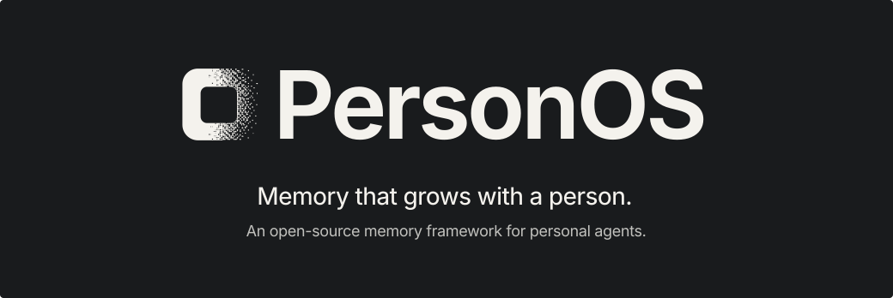

<picture>
  <source media="(max-width: 600px) and (prefers-color-scheme: dark)" srcset="docs/assets/brand/readme-hero-mobile-dark.svg">
  <source media="(max-width: 600px)" srcset="docs/assets/brand/readme-hero-mobile.svg">
  <source media="(prefers-color-scheme: dark)" srcset="docs/assets/brand/readme-hero-dark.svg">
  
</picture>

<p align="center">
  <br>
  <a href="https://github.com/2049lab/PersonOS/actions/workflows/ci.yml"></a>
  <a href="pyproject.toml"></a>
  <a href="LICENSE"></a>
  <a href="RELEASE.md"></a>
</p>


<p align="center">
  <a href="#quick-start"><picture><source media="(prefers-color-scheme: dark)" srcset="docs/assets/brand/nav-start-dark.svg"></picture></a>
  <a href="docs/usage.md"><picture><source media="(prefers-color-scheme: dark)" srcset="docs/assets/brand/nav-docs-dark.svg"></picture></a>
  <a href="examples/README.md"><picture><source media="(prefers-color-scheme: dark)" srcset="docs/assets/brand/nav-examples-dark.svg"></picture></a>
  <a href="README.zh-CN.md"><picture><source media="(prefers-color-scheme: dark)" srcset="docs/assets/brand/nav-language-dark.svg"></picture></a>
</p>

**PersonOS is an open-source long-term memory framework for personal agents.** It organizes a person's preferences, relationships, goals and experiences into retrievable memories across conversations, preserving the original context and how information changes over time.

Use it through Python or the optional HTTP service. Start with text and local SQLite, bring your own chat and embedding models, and add shared storage, image understanding or video person association when your application needs them.

## Core capabilities

- **Memory organized around people** — Extract personal information from conversations, retain its context, and scope memories by user and session.
- **Recall with evidence** — Retrieve relevant memories and their sources as material for your agent, or generate answers with citations.
- **Context that keeps its history** — Connect new and earlier statements through memory chains, retain past records, and consolidate episodes into user profiles.
- **Composable integration** — Use Python or HTTP, configure models, storage and retrieval behavior, and enable multimodal backends as needed.

## Quick start

Requires **Python 3.10+**, a chat model and an embedding model. Install from source to use the APIs described on this branch; the published PyPI package may lag behind it.

```bash
git clone https://github.com/2049lab/PersonOS.git
cd PersonOS
python -m venv .venv
source .venv/bin/activate
python -m pip install -e .

export PERSONOS_LLM_API_KEY="your-api-key"
export PERSONOS_LLM_BASE_URL="https://api.openai.com/v1"
export PERSONOS_LLM_MODEL="gpt-4o-mini"
export PERSONOS_EMBEDDING_MODEL="text-embedding-3-small"
export PERSONOS_EMBEDDING_DIM=1536

personos doctor
```

The defaults above require access to both models. `doctor` checks configuration and dependencies, without making a model request. For Windows, other providers and separate embedding endpoints, see [installation and configuration](docs/usage.md#text-memory).

```python
from personos import Memory

with Memory() as memory:
    memory.add(
        "I moved from Hangzhou to Shanghai in June 2026.",
        user_id="alice",
        session_id="conversation-1",
    )
    memory.end_session(
        user_id="alice", session_id="conversation-1", sync=True,
    )

    result = memory.search("Where do I live?", user_id="alice")
    print(result.ans.answer if result.ans else "No answer returned.")
    print(result.ans.cited_cells if result.ans else [])
```

`add()` queues the input. `end_session(sync=True)` closes the trailing episode and waits for ingestion before the read. The expected answer refers to Shanghai; the result depends on your models. Data remains available for later conversations.

## How memory is organized

The original statement is kept as **evidence**. An **episode** preserves the move and its context; **atoms** make individual facts retrievable. Queries find those atoms and read the corresponding episodes. As new observations arrive, **chains** connect related statements while keeping earlier records available. A separate **profile** consolidates the accumulated episodes.

The text write path focuses on the person. Facts, plans and grounded experiences can become memory; task instructions, assistant suggestions and procedural exchanges do not become personal facts merely because they appear in a conversation. A segment without relevant personal content may retain evidence without producing an episode or atoms. Extraction is model-driven, so inspect evidence when correctness matters.

Read the [framework design and upgrade notes](docs/framework.md) for the memory boundary, empty results and compatibility changes.

## Use it in your agent

```python
with Memory() as memory:
    # Retrieve material for your agent to use in its own response.
    result = memory.search("Where do I live?", user_id="alice", mode="flash")
    materials = result.to_public()["materials"]

    # Inspect stored memories without a model call.
    page = memory.list_memories(user_id="alice", session_id="conversation-1", limit=20)
    chains = memory.list_chains(user_id="alice", limit=20)
```

`flash` skips answer generation and review; it still uses embeddings and any configured reranker. The [API guide](docs/usage.md#core-api) covers pagination, chain history, provenance, profiles and queue behavior.

Library operations are scoped by `user_id`; the [HTTP service](server/README.md) binds memory operations to a user token. SQLite and local media live under `~/.personos` by default. Inference uses your configured model endpoints. For multiple workers, configure shared MySQL and Redis.

## Explore further

| Resource | Start here for |
|---|---|
| [Usage guide](docs/usage.md) | Model configuration, optional dependencies and the Python API |
| [Framework design](docs/framework.md) | Memory layers, scope, changes and deferred capabilities |
| [Runnable examples](examples/README.md) | Text history, images and video ingestion |
| [HTTP service](server/README.md) | API authentication, queues and deployment |
| [Evaluation](docs/evaluation.md) | Historical results, protocols and reproduction status |
| [Animated case study](docs/case-study.md) | An illustrated video identity workflow, with storyboard and source |
| [Configuration reference](.env.example) | Provider, storage, worker and tracing settings |

The framework is **alpha**. Historical benchmark scores have not been re-established for this revision; complete manifests and per-question artifacts are not yet published. See the evaluation notes before using those scores for comparisons.

## Contributing

Bug reports, regression tests, provider integrations and documentation improvements are welcome. [CONTRIBUTING.md](CONTRIBUTING.md) covers the local test suite and release checks. Report security issues through [SECURITY.md](SECURITY.md).

Developed at [2049lab](https://github.com/2049lab) as part of the [PersonOS initiative](https://personos-ai.com/). The wider research roadmap and ecosystem applications are described on the website; their capabilities are separate from this library.

[Apache 2.0](LICENSE) · [GitHub Issues](https://github.com/2049lab/PersonOS/issues) · [Releases](https://github.com/2049lab/PersonOS/releases) · [PyPI](https://pypi.org/project/personos/)

External model weights and datasets retain their own licenses. The optional M3-Bench sample is provided by [ByteDance-Seed](https://github.com/bytedance-seed/m3-agent) under CC BY-NC-SA 4.0.
