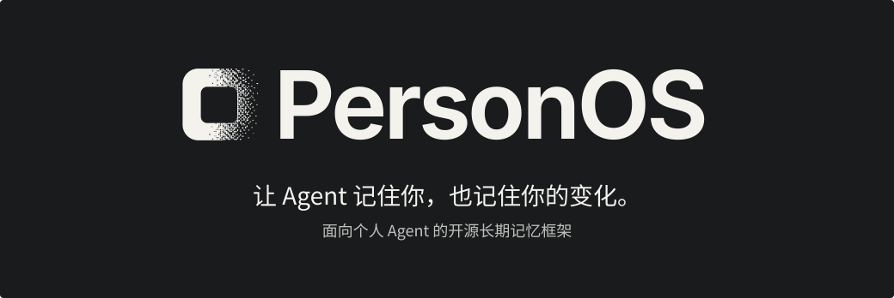

<picture>
  <source media="(max-width: 600px) and (prefers-color-scheme: dark)" srcset="docs/assets/brand/readme-hero-zh-mobile-dark.svg">
  <source media="(max-width: 600px)" srcset="docs/assets/brand/readme-hero-zh-mobile.svg">
  <source media="(prefers-color-scheme: dark)" srcset="docs/assets/brand/readme-hero-zh-dark.svg">
  
</picture>

<p align="center">
  <br>
  <a href="https://github.com/2049lab/PersonOS/actions/workflows/ci.yml"></a>
  <a href="pyproject.toml"></a>
  <a href="LICENSE"></a>
  <a href="RELEASE.md"></a>
</p>


<p align="center">
  <a href="#快速开始"><picture><source media="(prefers-color-scheme: dark)" srcset="docs/assets/brand/nav-start-zh-dark.svg"></picture></a>
  <a href="docs/usage.zh-CN.md"><picture><source media="(prefers-color-scheme: dark)" srcset="docs/assets/brand/nav-docs-zh-dark.svg"></picture></a>
  <a href="examples/README.md"><picture><source media="(prefers-color-scheme: dark)" srcset="docs/assets/brand/nav-examples-zh-dark.svg"></picture></a>
  <a href="README.md"><picture><source media="(prefers-color-scheme: dark)" srcset="docs/assets/brand/nav-language-zh-dark.svg"></picture></a>
</p>

**PersonOS 是面向个人 Agent 的开源长期记忆框架。** 它将用户在不同对话中分享的偏好、关系、目标与经历组织成可检索的记忆，让 Agent 延续对用户的了解，同时保留信息的来源与变化过程。

框架提供 Python 接口与可选的 HTTP 服务。你可以从文本和本地 SQLite 开始，使用自己的对话模型与向量模型，再按需要接入共享存储、图片理解和视频人物关联。

## 核心能力

- **围绕用户组织记忆** — 从交流中提取个人信息，保留完整情景，按用户与会话管理。
- **召回时带上依据** — 返回相关记忆及原始证据，可直接为 Agent 提供材料，也可生成带引用的答案。
- **保留上下文的变化** — 通过记忆链关联新旧陈述，保留历史，并从积累的情景中整理用户画像。
- **按应用需要组合** — 支持 Python 与 HTTP 接入；模型、存储和召回方式可配置，多模态能力按需启用。

## 快速开始

需要 **Python 3.10+**、对话模型和向量模型。使用源码安装来运行当前分支描述的 API；PyPI 上的已发布版本可能尚未包含这些更新。

```bash
git clone https://github.com/2049lab/PersonOS.git
cd PersonOS
python -m venv .venv
source .venv/bin/activate
python -m pip install -e .

export PERSONOS_LLM_API_KEY="your-api-key"
export PERSONOS_LLM_BASE_URL="https://api.openai.com/v1"
export PERSONOS_LLM_MODEL="gpt-4o-mini"
export PERSONOS_EMBEDDING_MODEL="text-embedding-3-small"
export PERSONOS_EMBEDDING_DIM=1536

personos doctor
```

上面的默认配置需要能访问这两个模型。`doctor` 检查配置与依赖，不会调用模型。Windows 安装、其他服务商以及独立向量端点的配置见[安装与配置](docs/usage.zh-CN.md#文本记忆)。

```python
from personos import Memory

with Memory() as memory:
    memory.add(
        "我在 2026 年 6 月从杭州搬到了上海。",
        user_id="alice",
        session_id="conversation-1",
    )
    memory.end_session(
        user_id="alice", session_id="conversation-1", sync=True,
    )

    result = memory.search("我住在哪？", user_id="alice")
    print(result.ans.answer if result.ans else "没有返回答案。")
    print(result.ans.cited_cells if result.ans else [])
```

`add()` 将输入放入队列。`end_session(sync=True)` 关闭末尾情景片段，等待写入完成后再读取。预期答案会提到上海，实际结果取决于所用模型。数据会保留，后续对话可以继续使用。

## 记忆如何组织

原始陈述作为**证据**（evidence）保存；**情景**（episode）保留搬家的经过与上下文，**原子记忆**（atoms）让其中的事实可以被检索。查询找到原子记忆后，再读取对应情景。后续有新记录时，**记忆链**（chains）将相关陈述连接起来，旧记录仍可查看；**用户画像**（profile）则根据积累的情景单独整理。

文本写入关注用户本人。事实、计划和有依据的经历可以形成记忆；临时任务指令、助手建议与操作过程不会仅因出现在对话中就成为个人事实。没有相关个人内容的片段可以只保留证据，不生成情景或原子记忆。提取依赖模型，核对结果时应查看原始证据。

[框架设计与升级说明](docs/framework.zh-CN.md)解释了记忆范围、空结果和兼容性变化。

## 接入你的 Agent

```python
with Memory() as memory:
    # 返回材料，由你的 Agent 组织回答。
    result = memory.search("我住在哪？", user_id="alice", mode="flash")
    materials = result.to_public()["materials"]

    # 直接浏览已保存的记忆，不调用模型。
    page = memory.list_memories(user_id="alice", session_id="conversation-1", limit=20)
    chains = memory.list_chains(user_id="alice", limit=20)
```

`flash` 跳过答案生成和复核，仍会使用向量模型及已配置的重排服务。[API 指南](docs/usage.zh-CN.md#核心-api)说明分页、记忆链历史、溯源、画像与队列行为。

Python 接口按 `user_id` 限定操作范围；[HTTP 服务](server/README.md)通过用户 token 绑定记忆操作。默认使用 `~/.personos` 下的 SQLite 和本地媒体文件，推理走你配置的模型端点。多进程部署需要共享 MySQL 与 Redis。

## 继续了解

| 文档 | 内容 |
|---|---|
| [使用指南](docs/usage.zh-CN.md) | 模型配置、可选依赖与 Python API |
| [框架设计](docs/framework.zh-CN.md) | 记忆分层、适用范围、本次变化和暂缓能力 |
| [可执行示例](examples/README.md) | 文本事实变化、图片与视频接入 |
| [HTTP 服务](server/README.md) | API 鉴权、队列与部署 |
| [评测说明](docs/evaluation.zh-CN.md) | 历史结果、评测方法与复现状态 |
| [动画案例](docs/case-study.zh-CN.md) | 视频人物关联流程、分镜与动画源码 |
| [配置参考](.env.example) | 模型服务、存储、工作线程与追踪选项 |

框架当前处于 **alpha** 阶段。本次更新尚未重新验证历史 benchmark 分数，完整模型配置与逐题产物也尚未发布。引用分数或进行比较前，请先阅读评测说明。

## 参与开发

欢迎提交问题、回归测试、模型服务接入和文档改进。[CONTRIBUTING.md](CONTRIBUTING.md)说明本地测试与发布检查，安全问题请按 [SECURITY.md](SECURITY.md) 报告。

项目由 [2049lab](https://github.com/2049lab) 开发，是 [PersonOS](https://personos-ai.com/) 研究计划的一部分。更广泛的研究方向与生态应用在官网单独介绍，其能力与本框架分别说明。

[Apache 2.0](LICENSE) · [问题反馈](https://github.com/2049lab/PersonOS/issues) · [版本发布](https://github.com/2049lab/PersonOS/releases) · [PyPI](https://pypi.org/project/personos/)

外部模型权重与数据集保留各自许可。可选的 M3-Bench 样例由 [ByteDance-Seed](https://github.com/bytedance-seed/m3-agent) 提供，许可为 CC BY-NC-SA 4.0。
