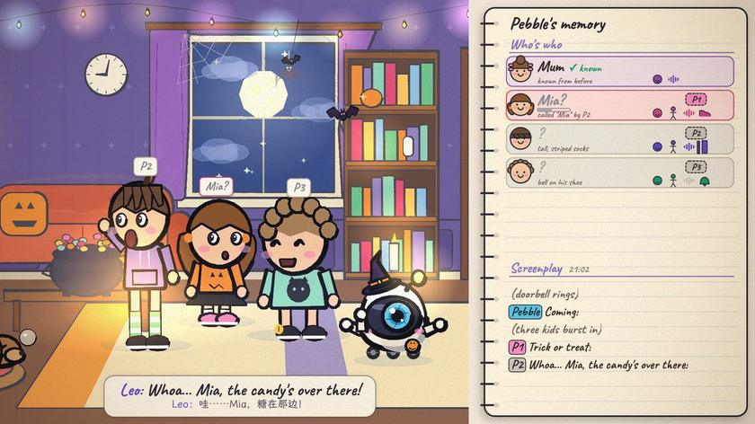
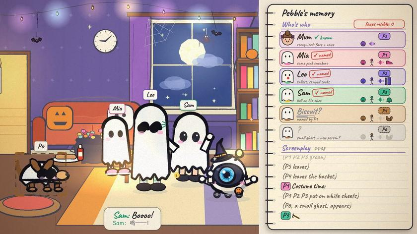
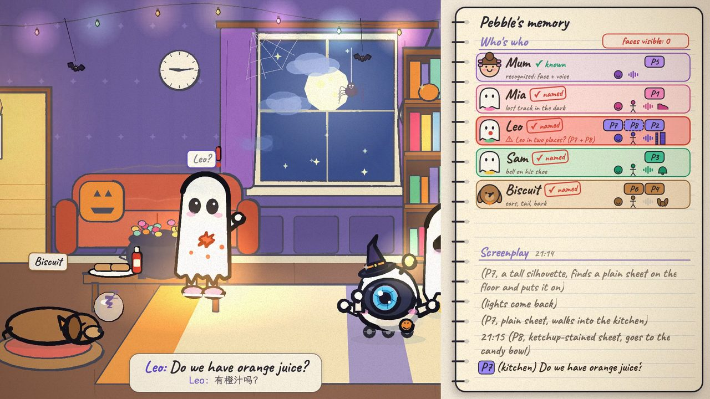
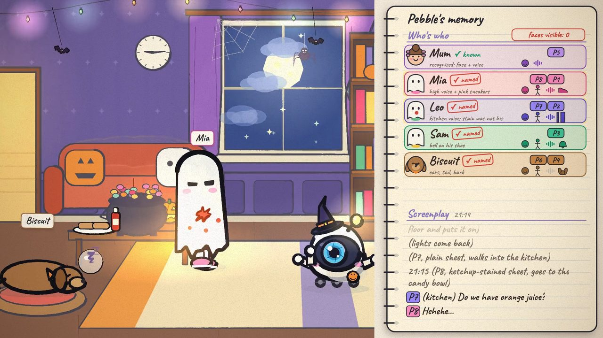
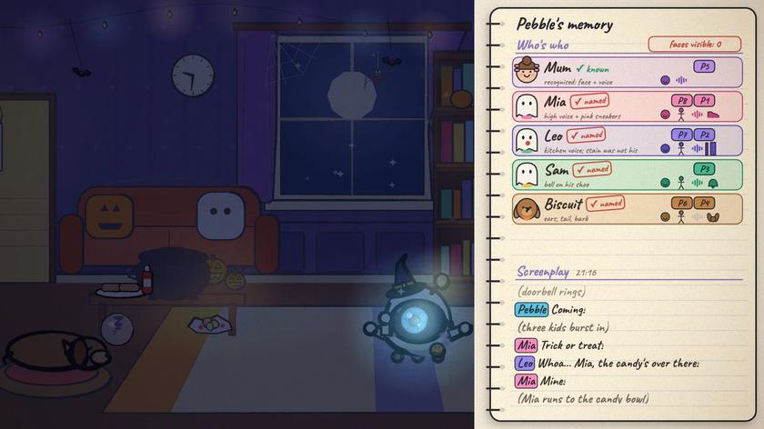
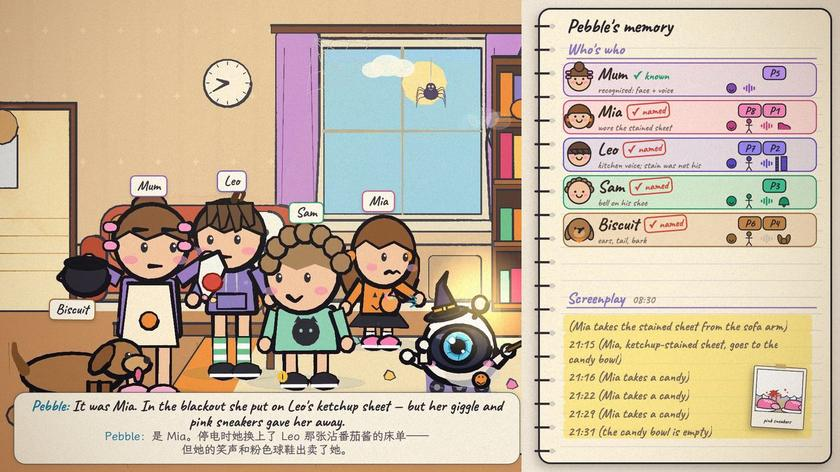

# Case study

[← PersonOS](../README.md) · [English](case-study.md) · [简体中文](case-study.zh-CN.md)

An animated walkthrough of identity resolution across video clips. Three children wear matching ghost costumes; new voice, location, and visual evidence helps resolve conflicting identity matches.

https://github.com/user-attachments/assets/252e5d6c-b959-4d2c-a06d-7cf5367a55da

Events are recorded with temporary person codes such as `P1` and `P2`, while identity hypotheses are maintained separately. New evidence can revise those hypotheses before session consolidation links observations to persistent characters. Retrieval then returns the relevant events and supporting material.

This is an animated design case, not a live robot recording or an accuracy test. The [animation source and storyboard](demo/README.md) are included; see the [video example](../examples/video.py) for an executable ingestion workflow.


## Who ate the Halloween candy?

Pebble, a small home robot, watches three children arrive for trick-or-treat. It initially knows none of them, learns candidate names from their conversations, and continues associating observations after they put on matching ghost costumes. During a blackout, Mia swaps into Leo's ketchup-stained sheet to make him appear responsible for taking the candy. Voices, locations, and a pair of pink sneakers provide evidence for revisiting that identity match.

The notebook on the right separates two records. An **episodic screenplay** records events using temporary person codes such as `P1` and `P2`; a **character table** holds hypotheses about who those codes refer to. New evidence revises the character table. When the session is saved, observations are linked to persistent characters. The next morning, Pebble uses the records to answer who ate the candy and show the supporting material.

<table>
  <tr>
    <td width="33%"></td>
    <td width="33%"></td>
    <td width="33%"></td>
  </tr>
  <tr>
    <td><b>Learn a name.</b> A spoken reference gives stranger <code>P1</code> the candidate name Mia, without prior enrollment.</td>
    <td><b>Combine cues.</b> With faces covered, voice, build, and spatio-temporal continuity can still help connect observations.</td>
    <td><b>Review a conflict.</b> The stained sheet suggests Leo, but Leo's voice comes from the kitchen. The earlier match needs review.</td>
  </tr>
  <tr>
    <td></td>
    <td></td>
    <td></td>
  </tr>
  <tr>
    <td><b>Revise the match.</b> A giggle and pink sneakers point to Mia. The temporary code is reassigned while the recorded events are preserved.</td>
    <td><b>Commit the session.</b> Consolidate evidence and link temporary identities to persistent characters. A person can remain unnamed when the evidence does not establish a name.</td>
    <td><b>Recall with evidence.</b> Answer “who ate the candy?” with the relevant screenplay events and the sneakers image as supporting material.</td>
  </tr>
</table>

## Event records in this scenario

These illustrative records describe the animation. An appearance-based description records the action; linking it to a person also makes the event usable for questions about who did what.

Appearance-based description:

```text
[21:15] A ghost in a ketchup-stained sheet went to the candy bowl.
[21:16] A ghost took a candy.
[21:22] A ghost took a candy.
[21:29] A ghost took a candy.
```

After identity resolution:

```text
[21:15] Mia, wearing Leo's ketchup-stained sheet, went to the candy bowl.
[21:16] Mia took a candy.
[21:22] Mia took a candy.
[21:29] Mia took a candy.
```
